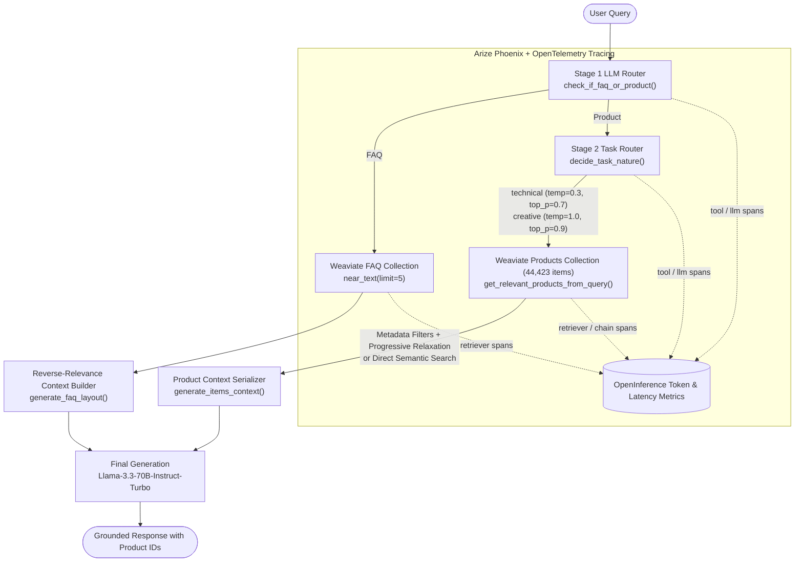

# E-Commerce RAG Assistant with Query Routing & OpenTelemetry Tracing

An end-to-end **Retrieval-Augmented Generation (RAG)** assistant designed for **Fashion Forward Hub**, an e-commerce clothing platform indexing **44,423 product records** and a store policy **FAQ knowledge base** in **Weaviate**.

This project focuses on **production RAG engineering**: reducing token costs, minimizing retrieval latency, dynamically routing queries across multiple vector collections, and instrumenting every pipeline stage with **OpenTelemetry** and **Arize Phoenix** observability.

---

## Architecture Overview



---

## Key Engineering Features

### 1. Two-Stage LLM Query Routing
- **Stage 1 (`check_if_faq_or_product`)**: Classifies incoming queries as either `FAQ` (returns, store policies, sizing, contact info) or `Product` (catalog items, price ranges, outfit styling) using `Qwen/Qwen3.5-9B` at `temperature=0`.
  - **Prompt Optimization**: Compressed the 8-shot baseline prompt (`~203 tokens`) into a zero-shot classification prompt (`~62 tokens`), cutting routing token usage by **69%** while maintaining **100% classification accuracy**.
- **Stage 2 (`decide_task_nature` & `get_params_for_task`)**: Classifies product queries into:
  - **`technical`** (factual lookups, prices, availability) $\rightarrow$ sets `temperature=0.3, top_p=0.7`.
  - **`creative`** (outfit composition, styling ideas) $\rightarrow$ sets `temperature=1.0, top_p=0.9`.

### 2. Dual-Index Weaviate Retrieval & Progressive Filter Relaxation
- **Semantic FAQ Retrieval (`query_on_faq`)**:
  - Replaces full-FAQ prompt stuffing (`1,116 tokens`) with deterministic UUIDv5 batch indexing and top-5 semantic vector search (`faq_collection.query.near_text(query, limit=5)`).
  - Reverses the top-5 retrieved FAQs so the most relevant entry appears closest to the user query at the bottom of the prompt, reducing FAQ token consumption by **65%** (`386 tokens`).
- **Product Catalog Search (`get_relevant_products_from_query`)**:
  - Queries **44,423 clothing items** across 10 structured attributes (`gender`, `masterCategory`, `subCategory`, `articleType`, `baseColour`, `season`, `year`, `usage`, `price`, `product_id`).
  - Supports **Weaviate `Filter.by_property(...)` metadata filtering** with automatic **progressive filter relaxation** (`importance_order`) when fewer than 10 items match, as well as **direct semantic search** (`simplified=True`) that eliminates the ~1,465-token metadata generation step entirely.

### 3. LLM Observability & Cost Telemetry (Arize Phoenix + OpenTelemetry)
- Manually instrumented with `phoenix.otel` and `opentelemetry.trace` (`tool`, `llm`, `retriever`, and `chain` spans).
- Logs **OpenInference semantic attributes** (`llm.token_count.prompt`, `llm.token_count.completion`, `llm.token_count.total`, `llm.model_name`, and `retrieval.documents.{i}.document.*`) to monitor token spend and latency per span.

---

## Benchmark: Baseline vs. Cost-Optimized Pipeline

| Pipeline Stage | Baseline (`simplified=False`) | Optimized (`simplified=True`) | Token Savings |
| :--- | :---: | :---: | :---: |
| **Stage 1 Router (`check_if_faq_or_product`)** | ~203 tokens | ~62–68 tokens | **~69% reduction** |
| **FAQ Retrieval (`query_on_faq`)** | 1,116 tokens (Full FAQ) | 386 tokens (Top-5 Weaviate `near_text`) | **~65% reduction** |
| **Stage 2 Router (`decide_task_nature`)** | ~185 tokens | ~50–71 tokens | **~65% reduction** |
| **Product Retrieval (`get_relevant_products_from_query`)** | ~1,465 LLM tokens (Metadata JSON) | 0 LLM tokens (Direct Weaviate `near_text`) | **100% filter-token savings** |
| **End-to-End Product Query (`answer_query`)** | ~2,929 total tokens | ~1,303 total tokens | **~55% overall reduction** |

---

## Repository Structure

```text
├── ecommerce_rag_assistant_weaviate.ipynb  # Complete notebook with executed outputs & token benchmarks
├── rag_pipeline.py                         # Modular Python implementation of routers, filters & Weaviate search
├── requirements.txt                        # Python dependencies
├── .gitignore                              # Standard Python/Jupyter gitignore
└── README.md                               # Project documentation & architecture
```

---

## Quick Start

1. **Install dependencies**:
   ```bash
   pip install -r requirements.txt
   ```
2. **Explore the Notebook**:
   Open `ecommerce_rag_assistant_weaviate.ipynb` in VS Code or JupyterLab to inspect the full step-by-step execution outputs, token comparisons, and Weaviate queries, or import the modular functions directly from `rag_pipeline.py`.
